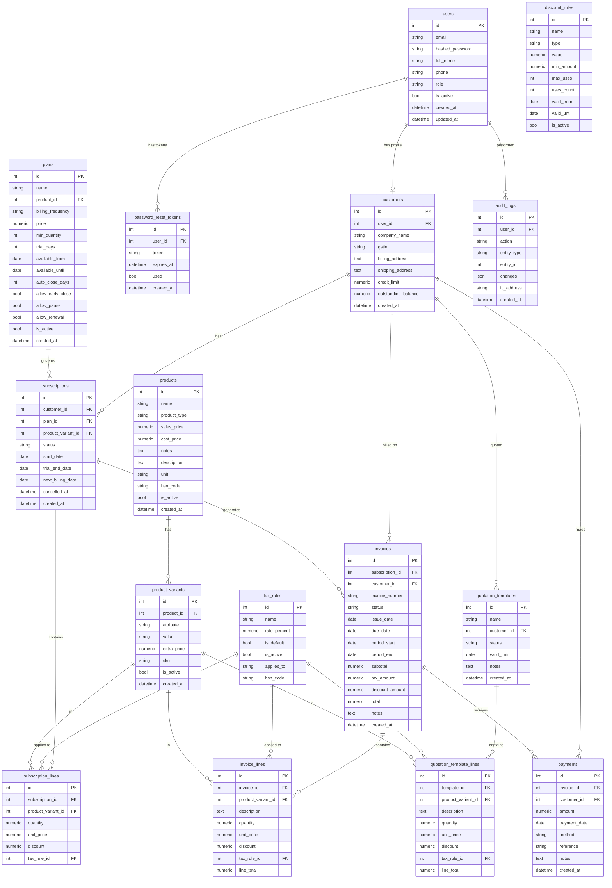

# SubSentry – Database Schema

> Generated from `backend/app/models/models.py`.  
> Engine: SQLite (development) / PostgreSQL-compatible (production).  
> All money columns: `NUMERIC(12, 2)`. Timestamps: UTC with timezone.

> [!NOTE]
> See [§ Reconciliation](#reconciliation) for columns that must be added/renamed before implementing routes.

---

## Table of Contents

1. [Tables](#tables)
2. [Indexes & Constraints](#indexes--constraints)
3. [Enum Reference](#enum-reference)
4. [Relationships](#relationships)
5. [ER Diagram](#er-diagram)
6. [Reconciliation](#reconciliation)

---

## Tables

### `users`

| Column | Type | Nullable | Default | Notes |
|---|---|---|---|---|
| `id` | INTEGER | NOT NULL | autoincrement | PK |
| `email` | VARCHAR(255) | NOT NULL | — | UNIQUE, indexed |
| `hashed_password` | VARCHAR(255) | NOT NULL | — | bcrypt hash |
| `full_name` | VARCHAR(255) | NOT NULL | — | |
| `phone` | VARCHAR(30) | NULL | — | |
| `role` | ENUM(`roleenum`) | NOT NULL | `customer` | `admin\|staff\|customer` |
| `is_active` | BOOLEAN | NOT NULL | `true` | |
| `created_at` | DATETIME(tz) | NOT NULL | `now()` | |
| `updated_at` | DATETIME(tz) | NOT NULL | `now()` | auto-updated |

**Indexes:** PK `id`, UNIQUE + idx `email`

---

### `customers`

| Column | Type | Nullable | Default | Notes |
|---|---|---|---|---|
| `id` | INTEGER | NOT NULL | autoincrement | PK |
| `user_id` | INTEGER | NOT NULL | — | FK → `users.id` CASCADE, UNIQUE, indexed |
| `company_name` | VARCHAR(255) | NULL | — | |
| `gstin` | VARCHAR(15) | NULL | — | Indian GST registration number |
| `billing_address` | TEXT | NULL | — | |
| `shipping_address` | TEXT | NULL | — | |
| `credit_limit` | NUMERIC(12,2) | NOT NULL | `0.00` | |
| `outstanding_balance` | NUMERIC(12,2) | NOT NULL | `0.00` | Running total; updated by payment service |
| `created_at` | DATETIME(tz) | NOT NULL | `now()` | |

**Indexes:** PK `id`, UNIQUE + idx on `user_id`

---

### `password_reset_tokens`

| Column | Type | Nullable | Default | Notes |
|---|---|---|---|---|
| `id` | INTEGER | NOT NULL | autoincrement | PK |
| `user_id` | INTEGER | NOT NULL | — | FK → `users.id` CASCADE, indexed |
| `token` | VARCHAR(255) | NOT NULL | — | UNIQUE, indexed; random hex |
| `expires_at` | DATETIME(tz) | NOT NULL | — | |
| `used` | BOOLEAN | NOT NULL | `false` | |
| `created_at` | DATETIME(tz) | NOT NULL | `now()` | |

---

### `products`

| Column | Type | Nullable | Default | Notes |
|---|---|---|---|---|
| `id` | INTEGER | NOT NULL | autoincrement | PK |
| `name` | VARCHAR(255) | NOT NULL | — | |
| `product_type` | ENUM(`producttypeenum`) | NOT NULL | `software` | `service|software|addon` |
| `sales_price` | NUMERIC(12,2) | NOT NULL | `0.00` | Base selling price |
| `cost_price` | NUMERIC(12,2) | NOT NULL | `0.00` | Cost price |
| `notes` | TEXT | NULL | — | Optional notes |
| `description` | TEXT | NULL | — | Optional extra |
| `unit` | VARCHAR(50) | NULL | — | e.g. `license`, `module` |
| `hsn_code` | VARCHAR(20) | NULL | — | Indian HSN classification |
| `is_active` | BOOLEAN | NOT NULL | `true` | soft-delete flag |
| `created_at` | DATETIME(tz) | NOT NULL | `now()` | |

---

### `product_variants`

| Column | Type | Nullable | Default | Notes |
|---|---|---|---|---|
| `id` | INTEGER | NOT NULL | autoincrement | PK |
| `product_id` | INTEGER | NOT NULL | — | FK → `products.id` CASCADE, indexed |
| `attribute` | VARCHAR(100) | NOT NULL | — | Dimension name e.g. `Brand` |
| `value` | VARCHAR(100) | NOT NULL | — | Dimension value e.g. `Odoo` |
| `extra_price` | NUMERIC(12,2) | NOT NULL | `0.00` | Price delta added to product sales_price |
| `sku` | VARCHAR(100) | NULL | — | UNIQUE (when provided) |
| `is_active` | BOOLEAN | NOT NULL | `true` | |
| `created_at` | DATETIME(tz) | NOT NULL | `now()` | |

---

### `plans`

| Column | Type | Nullable | Default | Notes |
|---|---|---|---|---|
| `id` | INTEGER | NOT NULL | autoincrement | PK |
| `name` | VARCHAR(255) | NOT NULL | — | |
| `product_id` | INTEGER | NULL | — | FK → `products.id` RESTRICT, indexed |
| `billing_frequency` | ENUM(`billingfrequencyenum`) | NOT NULL | — | `daily|weekly|monthly|yearly` |
| `price` | NUMERIC(12,2) | NOT NULL | — | Base price per cycle |
| `min_quantity` | INTEGER | NOT NULL | `1` | Minimum units required |
| `trial_days` | INTEGER | NOT NULL | `0` | |
| `available_from` | DATE | NULL | — | |
| `available_until` | DATE | NULL | — | Must be ≥ available_from if set |
| `auto_close_days` | INTEGER | NULL | — | |
| `allow_early_close` | BOOLEAN | NOT NULL | `true` | |
| `allow_pause` | BOOLEAN | NOT NULL | `true` | |
| `allow_renewal` | BOOLEAN | NOT NULL | `true` | |
| `is_active` | BOOLEAN | NOT NULL | `true` | |
| `created_at` | DATETIME(tz) | NOT NULL | `now()` | |

---

### `tax_rules`

| Column | Type | Nullable | Default | Notes |
|---|---|---|---|---|
| `id` | INTEGER | NOT NULL | autoincrement | PK |
| `name` | VARCHAR(100) | NOT NULL | — | e.g. `GST 18%` |
| `rate_percent` | NUMERIC(5,2) | NOT NULL | — | Percentage, e.g. `18.00` |
| `is_default` | BOOLEAN | NOT NULL | `false` | Default tax rule flag |
| `is_active` | BOOLEAN | NOT NULL | `true` | soft-delete flag |
| `applies_to` | ENUM(`taxappliestoenum`) | NULL | `all` | `all|product|hsn` |
| `hsn_code` | VARCHAR(20) | NULL | — | Used when `applies_to = hsn` |

---

### `discount_rules`

| Column | Type | Nullable | Default | Notes |
|---|---|---|---|---|
| `id` | INTEGER | NOT NULL | autoincrement | PK |
| `name` | VARCHAR(100) | NOT NULL | — | |
| `type` | ENUM(`discounttypeenum`) | NOT NULL | — | ⚠ see Reconciliation |
| `value` | NUMERIC(12,2) | NOT NULL | — | Amount or % |
| `min_amount` | NUMERIC(12,2) | NOT NULL | `0.00` | Minimum order value |
| `max_uses` | INTEGER | NULL | — | Null = unlimited |
| `uses_count` | INTEGER | NOT NULL | `0` | |
| `valid_from` | DATE | NULL | — | |
| `valid_until` | DATE | NULL | — | |
| `is_active` | BOOLEAN | NOT NULL | `true` | |

---

### `quotation_templates`

| Column | Type | Nullable | Default | Notes |
|---|---|---|---|---|
| `id` | INTEGER | NOT NULL | autoincrement | PK |
| `name` | VARCHAR(255) | NOT NULL | — | |
| `customer_id` | INTEGER | NULL | — | FK → `customers.id` SET NULL, indexed |
| `status` | ENUM(`quotationstatusenum`) | NOT NULL | `draft` | `draft\|sent\|accepted\|rejected` |
| `valid_until` | DATE | NULL | — | |
| `notes` | TEXT | NULL | — | |
| `created_at` | DATETIME(tz) | NOT NULL | `now()` | |

---

### `quotation_template_lines`

| Column | Type | Nullable | Default | Notes |
|---|---|---|---|---|
| `id` | INTEGER | NOT NULL | autoincrement | PK |
| `template_id` | INTEGER | NOT NULL | — | FK → `quotation_templates.id` CASCADE, indexed |
| `product_variant_id` | INTEGER | NULL | — | FK → `product_variants.id` SET NULL, indexed |
| `description` | TEXT | NULL | — | |
| `quantity` | NUMERIC(12,2) | NOT NULL | `1.00` | |
| `unit_price` | NUMERIC(12,2) | NOT NULL | — | |
| `discount` | NUMERIC(12,2) | NOT NULL | `0.00` | Flat amount |
| `tax_rule_id` | INTEGER | NULL | — | FK → `tax_rules.id` SET NULL, indexed |
| `line_total` | NUMERIC(12,2) | NOT NULL | `0.00` | Computed: `(unit_price × qty) − discount` |

---

### `subscriptions`

| Column | Type | Nullable | Default | Notes |
|---|---|---|---|---|
| `id` | INTEGER | NOT NULL | autoincrement | PK |
| `customer_id` | INTEGER | NOT NULL | — | FK → `customers.id` CASCADE, indexed |
| `plan_id` | INTEGER | NOT NULL | — | FK → `plans.id` RESTRICT, indexed |
| `product_variant_id` | INTEGER | NULL | — | FK → `product_variants.id` SET NULL, indexed |
| `status` | ENUM(`subscriptionstatusenum`) | NOT NULL | `trial` | ⚠ see Reconciliation |
| `start_date` | DATE | NOT NULL | — | |
| `trial_end_date` | DATE | NULL | — | |
| `next_billing_date` | DATE | NULL | — | indexed |
| `cancelled_at` | DATETIME(tz) | NULL | — | Set on close/cancel |
| `created_at` | DATETIME(tz) | NOT NULL | `now()` | |

> ⚠ **Missing columns**: `expiry_date` DATE, `payment_terms_days` INTEGER. See [Reconciliation](#reconciliation).

---

### `subscription_lines`

| Column | Type | Nullable | Default | Notes |
|---|---|---|---|---|
| `id` | INTEGER | NOT NULL | autoincrement | PK |
| `subscription_id` | INTEGER | NOT NULL | — | FK → `subscriptions.id` CASCADE, indexed |
| `product_variant_id` | INTEGER | NULL | — | FK → `product_variants.id` SET NULL, indexed |
| `quantity` | NUMERIC(12,2) | NOT NULL | `1.00` | |
| `unit_price` | NUMERIC(12,2) | NOT NULL | — | Computed at creation time |
| `discount` | NUMERIC(12,2) | NOT NULL | `0.00` | |
| `tax_rule_id` | INTEGER | NULL | — | FK → `tax_rules.id` SET NULL, indexed |

---

### `invoices`

| Column | Type | Nullable | Default | Notes |
|---|---|---|---|---|
| `id` | INTEGER | NOT NULL | autoincrement | PK |
| `subscription_id` | INTEGER | NULL | — | FK → `subscriptions.id` SET NULL, indexed |
| `customer_id` | INTEGER | NOT NULL | — | FK → `customers.id` CASCADE, indexed |
| `invoice_number` | VARCHAR(50) | NOT NULL | — | UNIQUE, e.g. `INV-2026-0001` |
| `status` | ENUM(`invoicestatusenum`) | NOT NULL | `draft` | ⚠ see Reconciliation |
| `issue_date` | DATE | NOT NULL | — | |
| `due_date` | DATE | NOT NULL | — | indexed |
| `period_start` | DATE | NULL | — | |
| `period_end` | DATE | NULL | — | |
| `subtotal` | NUMERIC(12,2) | NOT NULL | `0.00` | Sum of line totals before tax/discount |
| `tax_amount` | NUMERIC(12,2) | NOT NULL | `0.00` | |
| `discount_amount` | NUMERIC(12,2) | NOT NULL | `0.00` | |
| `total` | NUMERIC(12,2) | NOT NULL | `0.00` | `subtotal + tax_amount − discount_amount` |
| `notes` | TEXT | NULL | — | |
| `created_at` | DATETIME(tz) | NOT NULL | `now()` | |

**Constraints:**
- UNIQUE `(subscription_id, period_start)` — name `uq_invoice_sub_period`
- Index `ix_invoices_status` on `status`
- Index `ix_invoices_due_date` on `due_date`

---

### `invoice_lines`

| Column | Type | Nullable | Default | Notes |
|---|---|---|---|---|
| `id` | INTEGER | NOT NULL | autoincrement | PK |
| `invoice_id` | INTEGER | NOT NULL | — | FK → `invoices.id` CASCADE, indexed |
| `product_variant_id` | INTEGER | NULL | — | FK → `product_variants.id` SET NULL, indexed |
| `description` | TEXT | NULL | — | |
| `quantity` | NUMERIC(12,2) | NOT NULL | `1.00` | |
| `unit_price` | NUMERIC(12,2) | NOT NULL | — | |
| `discount` | NUMERIC(12,2) | NOT NULL | `0.00` | |
| `tax_rule_id` | INTEGER | NULL | — | FK → `tax_rules.id` SET NULL, indexed |
| `line_total` | NUMERIC(12,2) | NOT NULL | `0.00` | |

---

### `payments`

| Column | Type | Nullable | Default | Notes |
|---|---|---|---|---|
| `id` | INTEGER | NOT NULL | autoincrement | PK |
| `invoice_id` | INTEGER | NOT NULL | — | FK → `invoices.id` CASCADE, indexed |
| `customer_id` | INTEGER | NOT NULL | — | FK → `customers.id` CASCADE, indexed |
| `amount` | NUMERIC(12,2) | NOT NULL | — | |
| `payment_date` | DATE | NOT NULL | — | indexed |
| `method` | ENUM(`paymentmethodenum`) | NOT NULL | — | `cash\|bank_transfer\|upi\|card\|cheque` |
| `reference` | VARCHAR(255) | NULL | — | UTR / cheque no. / txn ref |
| `notes` | TEXT | NULL | — | |
| `created_at` | DATETIME(tz) | NOT NULL | `now()` | |

**Indexes:** `ix_payments_payment_date` on `payment_date`

---

### `audit_logs`

| Column | Type | Nullable | Default | Notes |
|---|---|---|---|---|
| `id` | INTEGER | NOT NULL | autoincrement | PK |
| `user_id` | INTEGER | NULL | — | FK → `users.id` SET NULL, indexed |
| `action` | VARCHAR(100) | NOT NULL | — | e.g. `create`, `update`, `delete` |
| `entity_type` | VARCHAR(100) | NOT NULL | — | e.g. `subscription`, `invoice` |
| `entity_id` | INTEGER | NULL | — | PK of the affected row |
| `changes` | JSON | NULL | — | `{before: {}, after: {}}` diff |
| `ip_address` | VARCHAR(45) | NULL | — | IPv4 or IPv6 |
| `created_at` | DATETIME(tz) | NOT NULL | `now()` | |

---

## Indexes & Constraints

| Table | Index / Constraint | Columns | Type |
|---|---|---|---|
| `users` | PK | `id` | PRIMARY |
| `users` | idx + UNIQUE | `email` | UNIQUE |
| `customers` | UNIQUE + idx | `user_id` | UNIQUE |
| `password_reset_tokens` | UNIQUE + idx | `token` | UNIQUE |
| `product_variants` | UNIQUE | `sku` | UNIQUE |
| `subscriptions` | idx | `status` | INDEX |
| `subscriptions` | idx | `next_billing_date` | INDEX |
| `invoices` | UNIQUE | `invoice_number` | UNIQUE |
| `invoices` | UNIQUE | `(subscription_id, period_start)` | UNIQUE |
| `invoices` | `ix_invoices_status` | `status` | INDEX |
| `invoices` | `ix_invoices_due_date` | `due_date` | INDEX |
| `payments` | `ix_payments_payment_date` | `payment_date` | INDEX |
| All FKs | idx on FK column | various | INDEX |

---

## Enum Reference

| Enum name (DB) | Values (current model) | Values (contract target) |
|---|---|---|
| `roleenum` | `admin\|staff\|customer` | same ✅ |
| `billingcycleenum` | `monthly\|yearly\|weekly` | `daily\|weekly\|monthly\|yearly` ⚠ |
| `subscriptionstatusenum` | `trial\|active\|paused\|cancelled\|expired` | `draft\|quotation\|confirmed\|active\|paused\|closed` ⚠ |
| `invoicestatusenum` | `draft\|sent\|paid\|overdue\|void` | `draft\|confirmed\|paid\|cancelled` ⚠ |
| `paymentmethodenum` | `cash\|bank_transfer\|upi\|card\|cheque` | same ✅ |
| `quotationstatusenum` | `draft\|sent\|accepted\|rejected` | same (template only) ✅ |
| `discounttypeenum` | `percentage\|flat` | `fixed\|percent` ⚠ |
| `taxappliestoenum` | `all\|product\|hsn` | same ✅ |

---

## Relationships

```
users ──1:1──▶ customers
users ──1:N──▶ password_reset_tokens
users ──1:N──▶ audit_logs

customers ──1:N──▶ subscriptions
customers ──1:N──▶ invoices
customers ──1:N──▶ payments
customers ──1:N──▶ quotation_templates

products ──1:N──▶ product_variants

plans ──1:N──▶ subscriptions

subscriptions ──1:N──▶ subscription_lines
subscriptions ──1:N──▶ invoices

invoices ──1:N──▶ invoice_lines
invoices ──1:N──▶ payments

quotation_templates ──1:N──▶ quotation_template_lines

tax_rules ──referenced by──▶ subscription_lines, invoice_lines, quotation_template_lines
product_variants ──referenced by──▶ subscription_lines, invoice_lines, quotation_template_lines
```

---

## ER Diagram



---

## Reconciliation

> Items below must be resolved in a backend task before routes are implemented.

### Missing columns — `plans` table

```sql
ALTER TABLE plans RENAME COLUMN billing_cycle TO billing_frequency;
-- Add: daily value to the billingcycleenum
ALTER TABLE plans ADD COLUMN product_id INTEGER REFERENCES products(id);
ALTER TABLE plans ADD COLUMN min_quantity INTEGER NOT NULL DEFAULT 1;
ALTER TABLE plans ADD COLUMN available_from DATE;
ALTER TABLE plans ADD COLUMN available_until DATE;
ALTER TABLE plans ADD COLUMN auto_close_days INTEGER;
ALTER TABLE plans ADD COLUMN allow_early_close BOOLEAN NOT NULL DEFAULT 1;
ALTER TABLE plans ADD COLUMN allow_pause BOOLEAN NOT NULL DEFAULT 1;
ALTER TABLE plans ADD COLUMN allow_renewal BOOLEAN NOT NULL DEFAULT 1;
```

### Missing columns — `subscriptions` table

```sql
ALTER TABLE subscriptions ADD COLUMN expiry_date DATE;
ALTER TABLE subscriptions ADD COLUMN payment_terms_days INTEGER NOT NULL DEFAULT 0;
```

### Enum values to update in `models.py`

| Enum | Current → Target |
|---|---|
| `BillingCycleEnum` | add `daily`; rename field to `billing_frequency` |
| `SubscriptionStatusEnum` | replace entirely: `draft\|quotation\|confirmed\|active\|paused\|closed` |
| `InvoiceStatusEnum` | replace: `draft\|confirmed\|paid\|cancelled` |
| `DiscountTypeEnum` | replace: `fixed\|percent` |
